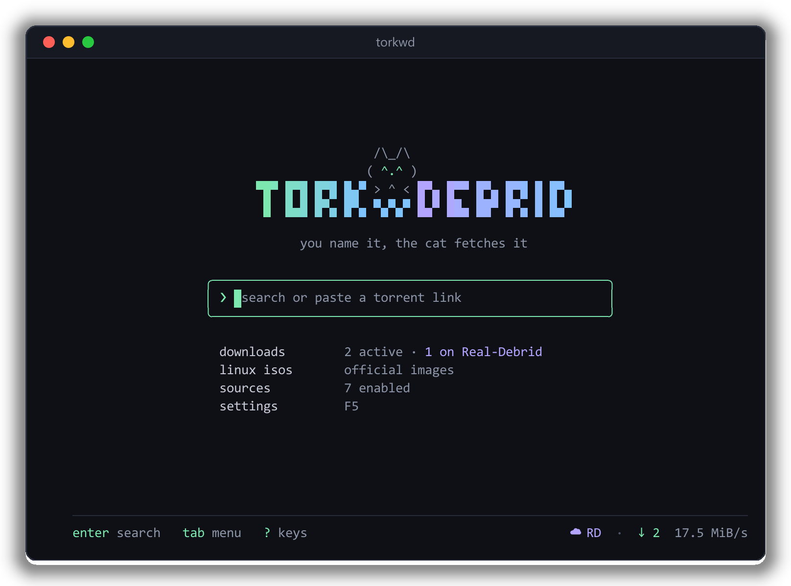
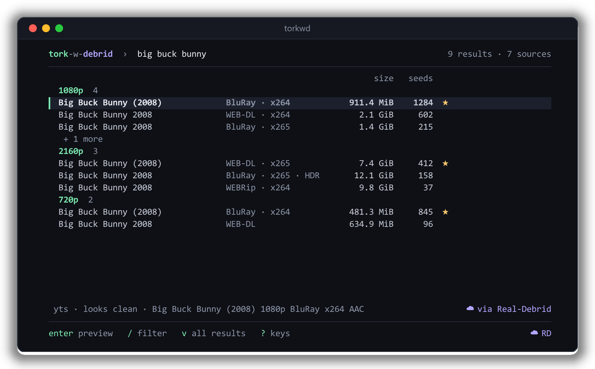
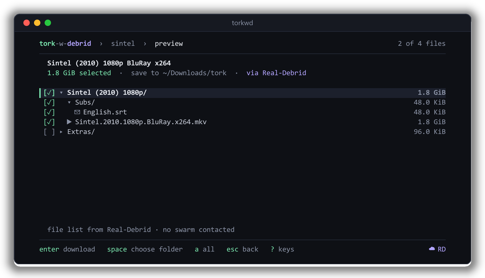
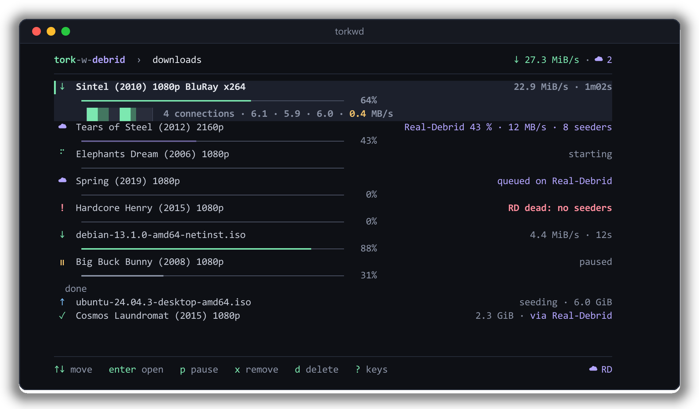
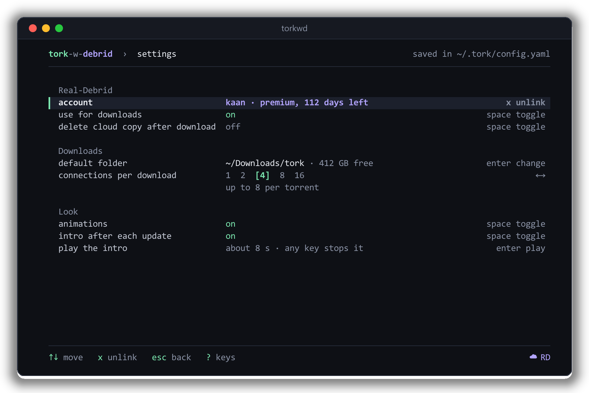
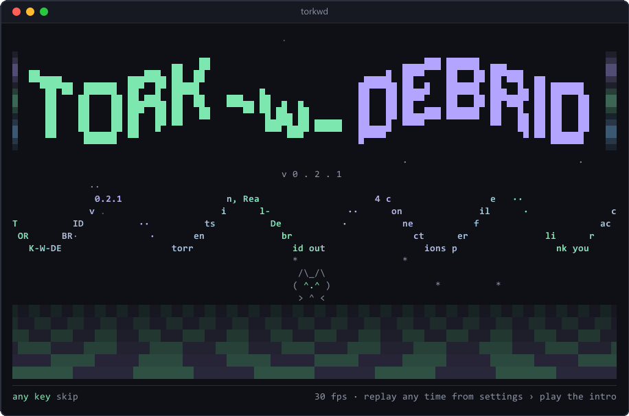
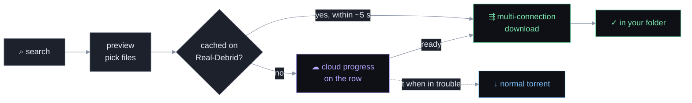

<div align="center">


**Torrent search in your terminal, downloaded at full speed through Real-Debrid.**

<a href="https://github.com/KaanEmec/tork-w-debrid/releases/latest"></a>


<a href="LICENSE"></a>
<a href="https://github.com/melqtx/tork"></a>

[Install](#install) · [Real-Debrid](#real-debrid) · [Screens](#screens) · [Keys](#keys) · [Configuration](#configuration)

<br>



</div>

<br>

## Why Tork-w-Debrid

A fork of [melqtx/tork](https://github.com/melqtx/tork) that keeps everything
upstream does and adds:

<table>
  <tr>
    <td width="33%" valign="top">
      <b>☁&nbsp; Real-Debrid built in</b><br>
      Link once with a device code. Cached torrents start at full speed; the rest finish in the cloud and come down by themselves.
    </td>
    <td width="33%" valign="top">
      <b>⇶&nbsp; Multi-connection downloads</b><br>
      Every Real-Debrid file comes down over several connections, written straight into place. No merge step.
    </td>
    <td width="33%" valign="top">
      <b>◐&nbsp; Nightglass look</b><br>
      A calm dark UI with one accent colour, gentle motion, and a demoscene intro after each update.
    </td>
  </tr>
  <tr>
    <td valign="top">
      <b>⌕&nbsp; 13 search sources</b><br>
      Knaben, YTS, Nyaa, TheRARBG, LimeTorrents, The Pirate Bay, EZTV, 1337x, Internet Archive and more, plus your own RSS and Torznab feeds.
    </td>
    <td valign="top">
      <b>⟳&nbsp; Self-update</b><br>
      <code>torkwd update</code> rebuilds the newest release from source, checked against the Go checksum database.
    </td>
    <td valign="top">
      <b>✓&nbsp; Everything from tork</b><br>
      Ranked results, file previews, verified Linux ISOs, strict SOCKS5 and Tor routing, health checks, background sessions.
    </td>
  </tr>
</table>

The command is `torkwd`, so it sits happily beside upstream `tork`. Both share
`~/.tork`.

## Install

```sh
go install github.com/kaanemec/tork-w-debrid/cmd/torkwd@latest
```

Needs Go 1.26.10 or newer. On Windows you can also grab `torkwd.exe` (amd64 or
arm64) from the [latest release](https://github.com/KaanEmec/tork-w-debrid/releases/latest).

> [!NOTE]
> Upstream's Homebrew, AUR and Nix packages install upstream `tork`, not this
> fork. On macOS, if Go picks up Nix's compiler, prefix the install with
> `CC=/usr/bin/clang CXX=/usr/bin/clang++`.

### Quick start

```sh
torkwd                     # open the UI and search
torkwd debrid login        # optional: link Real-Debrid (premium)
torkwd 'magnet:?xt=…'      # or jump straight to a magnet, hash, .torrent file or URL
```

Nothing downloads until you confirm it in the preview. Files land in
`~/Downloads/tork` unless you pick another folder in Settings (`F5`) or pass
`-d DIR`.

## Screens

<table>
  <tr>
    <td width="50%"></td>
    <td width="50%"></td>
  </tr>
  <tr>
    <td align="center"><b>Results</b><br><sub>duplicates folded, grouped by resolution, best picks starred</sub></td>
    <td align="center"><b>Preview</b><br><sub>choose files; extras start unticked</sub></td>
  </tr>
  <tr>
    <td width="50%"></td>
    <td width="50%"></td>
  </tr>
  <tr>
    <td align="center"><b>Downloads</b><br><sub>cloud progress, segment map, per-connection speed</sub></td>
    <td align="center"><b>Settings</b><br><sub>account, folder, connections and look, saved as you go</sub></td>
  </tr>
</table>

<details>
<summary><b>The intro</b>: plays once after each update, or any time with <code>torkwd intro</code></summary>
<br>
<p align="center"></p>
</details>

## Real-Debrid

Link a [Real-Debrid](https://real-debrid.com) account (premium) and torrents
download through it instead of the swarm.



```sh
torkwd debrid login        # shows a code and opens real-debrid.com/device
torkwd debrid status       # account, premium days left, on or off
torkwd debrid on | off     # use it for downloads, or not (stays linked)
torkwd debrid logout [-y]  # forget the link on this machine
```

You can link from Settings too (`F5` › Real-Debrid › account). Linking uses
Real-Debrid's device-code login only, with its open-source client ID; tokens
live in `~/.tork/debrid.json`, readable by you only.

- **Cached** torrents switch to a normal download within about 5 seconds.
- **Not cached?** The row shows Real-Debrid's progress with a `☁`, and the local
  download starts by itself when the cloud is done. torkwd has to be running for
  that step (on macOS and Linux the background session keeps it going).
- **In trouble?** If Real-Debrid refuses a torrent, can't be reached, or is
  stuck with no seeders, the row jumps to the top with a red `!` and says why.
  `t` downloads it as a normal torrent instead. It asks first and never
  switches by itself.
- **Removing** a row (`x`) asks whether to keep or delete the cloud copy (`c`).
  Debrid downloads don't seed. Autopilot and the Linux ISO shelf never use
  Real-Debrid.

> [!IMPORTANT]
> Real-Debrid sees every torrent you send it and every file you download from it.
> With Real-Debrid on, the preview never contacts the swarm, so peers never see
> your IP. Real-Debrid ties links to one IP: don't switch proxies mid-download.

### Multi-connection downloads

```yaml
debrid:
  connections: 4             # per file, 1-16 (Settings steps 1 · 2 · 4 · 8 · 16)
  max_total_connections: 8   # per torrent, shared between its files
  delete_after_download: false
```

Each segment is written straight into its place in the final file. A slow
connection is replaced, and idle ones steal the biggest piece left. Pick a
download on the Downloads screen to see its segment map and per-connection
speeds. The techniques come from [Surge](https://github.com/surge-downloader/surge)
(MIT); the code is tork's own `internal/engine/direct_parallel.go`.

## Keys

Press `?` anywhere for every key on the current screen.

| Where | Keys |
|---|---|
| **Everywhere** | `F1` home · `F2` results · `F3` downloads · `F4` sources · `F5` settings · `esc` back · `^c` quit |
| **Home** | type to search · `↓` menu · `tab` / `shift+tab` move between search and menu |
| **Results** | `enter` preview · `/` edit search · `f` filter · `o` sort · `z` hide dead · `ctrl+f` resolution & size · `v` all results · `s` source status · `D` grab now · `Y` copy magnet |
| **Preview** | `enter` download · `space` toggle file or folder · `←→` fold · `a` / `n` all or none |
| **Downloads** | `enter` open · `o` show in folder · `p` pause, resume or retry · `t` as a torrent · `s` seed · `v` verify · `m` move · `r` relink · `y` copy path · `x` remove · `d` delete files |
| **Sources** | `space` / `enter` on or off · `t` test · `r` check all · `a` add · `e` edit · `x` remove |
| **Settings** | `↑↓` move · `enter` change · `space` toggle · `←→` step |

Filter syntax for `f` in results:

```text
res:1080p,2160p seeders:>20 size:<8gb
codec:x265 -source:cam provider:nyaa is:trusted -is:dv
```

Fields: `res` `seeders` `size` `source` `codec` `provider` `category`, and
`is:trusted` `is:hdr` `is:dv` `is:pack`. Prefix any of them with `-` to negate.

## Commands

| Command | What it does |
|---|---|
| `torkwd [link]` | Open the UI, or a preview for a magnet, infohash, `.torrent` file or URL |
| `torkwd debrid …` | `login` · `status` · `on` · `off` · `logout` |
| `torkwd update` | Rebuild the newest release from source and swap it in (`--check`, `--force`) |
| `torkwd doctor` | Read-only check of config, disk, state and sources (`--record`, `--engine`, `--proxy-check`, `--debrid-check`) |
| `torkwd proxy …` | `tor` · `set [URL]` · `off` · `status` for strict SOCKS5 routing |
| `torkwd status` / `stop` | Inspect or stop the background session (macOS / Linux) |
| `torkwd autopilot "…"` | Describe what you want; it explains its picks and asks before queuing (WIP) |
| `torkwd intro` | Play the intro again |

Flags: `-d DIR` download folder for this run · `--torrent-url URL` ·
`--evil` never seed · `--foreground` stop transfers when the UI quits ·
`--config-dir DIR` · `--no-motion`.

## Configuration

Everything lives in `~/.tork/config.yaml`. Settings (`F5`) writes it for you as
you change things; the rest is optional.

<details>
<summary><b>Search sources and custom feeds</b></summary>
<br>

Open **sources** from home (`F4`). Knaben, YTS and Nyaa are on by default; the
rest are one key away and opt-in, so updates never widen what you search.
Sources are checked when you open the screen; `r` rechecks, `t` tests one.
A source blocked by site protection pauses for ten minutes while the others
keep going.

Press `a` for the catalog, or choose **Custom RSS / Torznab…** to add your own
feed (Jackett and Prowlarr endpoints work). `ctrl+s` tests and saves; a failing
feed can be saved disabled for later.

```yaml
providers:
  my_index:
    name: My index
    enabled: false
    type: torznab            # or rss, with {query} in search_url
    search_url: http://localhost:9117/api/v2.0/indexers/INDEXER/results/torznab/api
    api_key: YOUR_API_KEY
```

Feeds need v1 magnets or infohashes; `.torrent`-only and private trackers are
not supported. EZTV uses its official JSON API, with show names resolved
through TVmaze.
</details>

<details>
<summary><b>SOCKS5 and Tor</b></summary>
<br>

```sh
torkwd proxy tor                          # local Tor on 127.0.0.1:9050
torkwd proxy set socks5://127.0.0.1:1080  # any other SOCKS5 proxy
torkwd proxy set                          # prompts, hidden, for a URL with credentials
torkwd doctor --proxy-check               # ask the Tor Project what IP it sees
```

Proxy mode is strict: searches, trackers and peers all go through it, and
DHT, uTP, UDP trackers, inbound peers and port forwarding are turned off rather
than risk a direct connection. The UI shows `SOCKS strict`, or `Tor strict` once
a live check confirms a Tor exit. Credentials require a `0600` config file.
</details>

<details>
<summary><b>Background session</b></summary>
<br>

On macOS and Linux, closing the UI leaves downloads and seeding running in a
private local session; run `torkwd` again to reconnect. `torkwd status` checks
it and `torkwd stop` saves and stops it. It never opens a network port and
installs no startup service. Windows runs in the foreground, as does
`--foreground` everywhere.
</details>

<details>
<summary><b>Health checks</b></summary>
<br>

`torkwd doctor` is read-only. `--record` saves source results to
`~/.tork/health.json`, which `H` in the UI charts over time. For a local daily
check:

```yaml
health:
  enabled: true
  interval_hours: 24
```
</details>

<details>
<summary><b>Look and motion</b></summary>
<br>

Animations run at 10 fps and only while something moves. `--no-motion`,
`NO_COLOR`, `TERM=dumb` or a non-terminal output turns them off. ASCII mode
switches on by itself when the terminal can't draw the glyphs; force it with
`TORKWD_ASCII=1` (or off with `0`). Terminals down to 50 × 20 work.
</details>

<details>
<summary><b>Torrent and direct-download tuning</b></summary>
<br>

```yaml
metadata_cache:          # private copy of metadata: reopening a magnet needs no peers
  enabled: true
  max_mb: 256
  max_entries: 512

direct:                  # Linux ISO shelf
  max_connections: 4
  min_chunk_size: "10MB"
  enable_chunking: true

torrent_tuning:          # zero or missing keeps the anacrolix defaults
  half_open_conns_per_torrent: 25
  total_half_open_conns: 100
  peer_high_water: 500
  peer_low_water: 50
  download_rate_limit: 0 # bytes per second, client-wide
  upload_rate_limit: 0
  no_upload: false       # true also stops seeding
```

Verification rehashes torrent pieces and checks published SHA-1/256/512
digests; a mismatch is moved aside as `.corrupt` before retrying.
</details>

<details>
<summary><b>Autopilot (WIP)</b></summary>
<br>

```sh
torkwd autopilot "all breaking bad seasons 1080p under 40GB"
torkwd autopilot --dry-run --min-seeders 20 "dune 2024 2160p"
```

It shows its picks, sizes, reasons and what it rejected before asking to queue
anything. `--headless` skips the UI; scripts need `--yes`. Every decision is
logged to `~/.tork/autopilot.jsonl`. Defaults can live under `autopilot:` in
the config.
</details>

## Update and build

```sh
torkwd update            # newest tagged release of this fork, built from source
torkwd update --check    # only say whether one exists
```

`update` builds with `go install`, so the source is checked against
sum.golang.org, then swaps the binary in place. It never pulls upstream tork.
Homebrew, AUR and Nix installs are left to their package manager.

From a checkout:

```sh
go run ./cmd/torkwd                                  # run it
go build -o ./bin/torkwd ./cmd/torkwd && ./bin/torkwd  # or build it
```

## Credits and legal

Built on [tork](https://github.com/melqtx/tork) by melqtx. Segmented-download
ideas from [Surge](https://github.com/surge-downloader/surge). MIT, see
[LICENSE](LICENSE).

> [!CAUTION]
> Tork-w-Debrid is a BitTorrent client and search tool. It hosts nothing,
> runs no trackers and doesn't control the sites it searches. Use it for content
> you're allowed to download and share, such as Linux ISOs, public-domain media,
> open-source software and your own files. A proxy is not a promise of anonymity.

<div align="center">
<sub>you name it, the cat fetches it</sub>
<br>
<code>/\_/\ ( ^.^ ) &gt; ^ &lt;</code>
</div>
